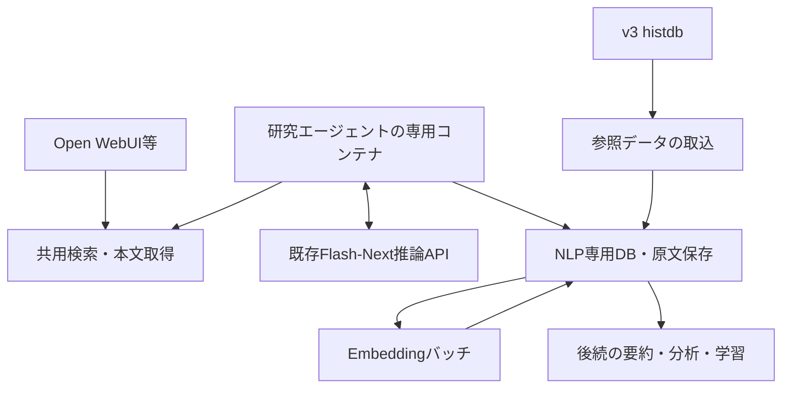

# keibaAI_nlp 引き継ぎ書 研究用データ蓄積基盤の整備

> **2026-11-24追記:** 段階2A〜3B完了後の引き継ぎ正本は [2026-11-24_stage3b_completed_handover.md](2026-11-24_stage3b_completed_handover.md) です。本書は11月22日時点の歴史資料として保持します。初期v3参照取込・PoC移行・詳細DB設計・検索/実行環境の未決事項など、その後の確定仕様と矛盾する記述は新しい引き継ぎ書および段階2B/3Bの正本を優先してください。

更新日: 2026-11-22（JST）  
対象: keibaAI_nlp、および連携する検索基盤・v3参照データ  
位置付け: ここまでの議論、PoCの到達点、次段階の計画。個別の実装指示書は作業ごとに分ける。

## 1. 当面のゴール

**インターネット上で入手可能な競馬の自然言語情報を継続的に発見・取得し、原文・出典・時刻・対象との関係を保った研究用データとして蓄積する。**

後で下馬評の要約、意味検索、Embeddingを使った機械学習、v3への特徴量提供を試せる土台を作る。今の到達目標は、予測力を証明することやLLMに勝ち馬を予想させることではなく、これらを検証できるデータが増え続ける状態を作ることである。

データの正本は専用DBと必要な永続保存領域に置く。エージェントの会話履歴・メモリ・要約だけを蓄積先にしない。原文を保持するため、Embeddingモデルやチャンク分割を後から変更できる構成を目指す。

### 当面の完了条件案

- 開発PCが停止していても、指定した収集タスクを常時起動環境で実行できる。
- エージェントが共用検索基盤を実際に呼び出し、検索結果に応じた追加探索と本文取得を行える。
- 発見URL、取得できた原文、出典、公開・観測時刻、取得状態、探索履歴を永続保存できる。
- v3から取り込んだ参照情報により、解決できるレース・馬を照合できる。未解決の記事も失わず残せる。
- 中断・再起動・同一タスクの再実行で、保存済みデータを失わず、同じ内容を無制御に増殖させず、続きを処理できる。
- 保存データを抽出して確認でき、バックアップからの復元を確認できる。

Embeddingの全件生成、Dashboard完成、予測精度改善、v3本番への組込みは、この段階の必須完了条件に含めない。

## 2. 議論の到達点と維持する方針

### 2.1 研究の目的

長期的な用途は次の2つである。[共通規約][N1]

1. **見て楽しむ下馬評の整理**: レースの出走馬について、新聞・専門家の予想、陣営コメント、取材記事などを出典付きで要約する。
2. **自然言語情報の予測力の研究**: 原文のEmbedding等を入力とする別の統計・機械学習モデルを学習し、既存の数値データに追加価値があるかを調べる。

LLM自身のweightを更新することは収集基盤の条件ではない。LLMは探索・文章理解を担い、予測モデルの学習は後の研究工程とする。単一の手作りスコアへ早期に圧縮せず、原文と派生データを残す。

### 2.2 収集方針

- 対象に関連し、入手・保存できる情報を広く蓄積する。収集時に「予測に効きそう」という理由だけで選別しない。
- 大レース、有名馬、著名な種牡馬の産駒ほど記事が多いなど、情報量の偏りは想定内とする。条件戦の記事がゼロでも、それ自体を失敗としない。
- レースごとに同じ媒体・記事数・情報項目を揃えることを目標にしない。
- 取得先を固定した巡回だけに限定せず、LLMによる検索語の組替え、人物・馬・出来事への展開、記事内の手掛かりの追跡を重視する。
- 「入手可能なものを全て」は収集の方向性であり、Web全体の完全網羅を宣言するものではない。実行ごとの範囲・探索履歴・保留事項を残し、継続して増やす。
- 未発見、未探索、本文取得不可、検索障害、解析失敗を区別する。転載や同一発言の重複は関係を記録する。
- 429等の制限に従って待機し、過度なアクセスを避ける。アクセス制限の回避を取得手段にしない。

初期対象は過去のJRA G1を出発点とし、将来の条件戦等への拡張を妨げない。各タスクの検索回数や期間の上限は運用上の予算であり、レースごとの情報量の基準ではない。

### 2.3 プロジェクトと担当の境界

- keibaAI_nlpはv3とは独立した研究プロジェクトとする。
- 共用検索サービスは既存OpenWebUI側の実装を基点に整備し、競馬固有の探索・ID照合・保存はNLP側に置く。
- v3はレース・馬・出走関係などの参照情報の供給元とする。DuckDB全体の置換や周辺機能の全面移行は今回の計画に含めない。
- 担当をChatGPT、Codex、Hermes、OpenCode等に固定しない。「指示書 → 実装・調査・検証 → 実施レポート → Gitで引渡し」の流れを維持する。
- 指示書は目的ごとに小さく分ける。本書を一括して実装する長大な指示書にはしない。

## 3. 実施済みPoCと現在地

以下は既存レポートと2026-11-22時点のリポジトリを照合した整理であり、今回の引き継ぎ作成時に実機試験を再実行した値ではない。

| PoC | 確認できたこと | まだ確認・実装できていないこと |
|---|---|---|
| CPU Embedding環境（5d2e2f6） | 開発PCのRyzen 7 5800XでQwen3-Embedding-0.6Bが動作。短文14件はfp32で0.77秒、ピークメモリはレポート表記で約2,841 MB。1024次元。 | 常時稼働先での速度・メモリ、大量処理、永続的なベクトル保存。否定・極性の混同あり。 |
| G1記事自律探索（b070dac） | 2024・2025・2026年の皐月賞から24件のURL付きレコードを保存。原文抜粋とLLM要約を分離。23件の原文をEmbeddingし、追加した3照会はTop1が期待通り。 | 大半が短い抜粋で、スニペット由来も多い。全文のコーパス、ID照合、継続運用、予測力の検証は未実施。 |
| Yahoo検索ローカルPoC（25a6484） | Yahoo実検索11回は全てHTTP 200。固定4クエリの比較と追加6回の探索で新規URL候補25件を発見。 | Hermesのnative MCPツールとしての直接呼出は未検証。本文取得は試験対象外。実429は発生しておらず、待機処理は模擬応答による確認。 |

出典: [Embeddingレポート][N2]、[記事探索レポート][N3]、[Yahoo比較レポート][N4]。

### 成果の読み方

- 新規URL25件は発見候補であり、本文を取得・確認した独立記事25件という意味ではない。
- ローカルYahoo PoCはPythonのstdioクライアントがサーバープロセスを起動する方式。常駐HTTPサーバーを構築した結果ではない。Hermesの検索語選択と、MCPツールの直接利用の検証を混同しない。
- Embeddingの類似検索に成功しても、競走結果に対する予測力が証明されたわけではない。逆に、否定を含む検索の誤りだけで、教師あり学習に使う価値がないとも判断しない。
- 現在のEmbeddingスクリプトがJSONへ保存するのは検索結果とベクトルの健全性統計であり、ベクトル本体の永続保存ではない。[現行実装][N5]
- 記事探索レポートにある「他のG1でも同じ程度収集できるか」「毎レース同じ骨格を得る」という提案は、現在の主目的には採用しない。
- Yahoo比較レポート末尾の「ローカル方式を継続推奨」は、その後の議論で既存コンテナの共用化を優先する方向に変わった。

### 引き継ぐデータ

既存の `data/poc/g1_passages.jsonl` と `embedding_search*_results.json`、`yahoo_*.json` はGit管理外である。コードをcloneするだけでは実データは戻らない。DB移行時に実体の所在と内容を確認し、原ファイルを保持して取り込む。過去のチャットに添付されたファイルは復元候補となるが、運用上の正本・バックアップ先は別途決める。

PoCの24件には本文抜粋・検索スニペット・原文なしが混在するため、同じ品質の全文データとして一括登録しない。公開日時の自由記述、取得方法、複数馬を含む文章も移行時の整理対象とする。

## 4. 目指す構成と責務

以下は今後具体化する構成案であり、DB製品・ホスト・通信方式まで確定した設計ではない。

| 構成要素 | 責務 | 設計上の境界 |
|---|---|---|
| 共用検索・本文取得サービス | 検索、URL先の取得、応答の整形、共通アクセス制御 | race_keyや競馬の探索戦略を持たない。通常会話でも使える。 |
| 研究エージェント | 対象に応じた検索計画、追加探索、文章解釈、進捗管理 | Hermesは有力候補だが固定しない。LLM推論本体とは別に動く。 |
| 保存・検証処理 | 型の検証、重複処理、履歴保存、ID照合結果の記録 | エージェントの出力を検証し、決まった処理でDBへ反映する。 |
| NLP専用DBと保存領域 | 取得内容・由来・参照情報・進捗の永続管理 | エージェントやコンテナを交換してもデータを引き継げる。 |
| Embedding処理 | 保存した原文の分割・ベクトル化・生成情報の記録 | 収集と別工程。未処理の原文を後から処理できる。 |
| 既存LLM推論サービス | Flash-Nextによる文章理解・判断 | 新しいエージェントコンテナにLLMのweightを積む前提にしない。 |

既存の小規模k8sにDB・エージェント・Embeddingを全て同居させるとは決めていない。配置先と資源配分は次の設計で選ぶ。開発PCは実験用に使えるが、常時収集の起動条件にはしない。

## 5. 検索基盤の整備

### 5.1 現行サービス

OpenWebUI側にはYahoo検索と `visit_page` を公開する既存コンテナがある。公開方式はmcpoによる**OpenAPI HTTP**、ServiceはClusterIPである。Hermes等向けのnative HTTP MCPと同一ではなく、LANに公開するだけで接続互換性が完成するわけではない。[既存README][S1]・[Service設定][S2]

Yahoo検索の現行コードは第1ページから最大10件、snippet最大300文字を返す。既存コンテナ側には429待機がなく、ローカルPoCに加えた処理も共有クールダウンを持たず、Retry-Afterの日時形式を扱わない。この差分を整理してから共用化する。[コンテナ側実装][S3]・[ローカルPoC実装][N6]

### 5.2 次に具体化する機能

| 優先 | 機能 | 目的・判断点 |
|---|---|---|
| 高 | 複数クライアントからの共用 | Hermes等のエージェントとOpen WebUIが使える公開方式・接続経路を選び、両方で実呼出を確認する。 |
| 高 | 構造化した検索・取得結果 | URL、タイトル、snippet、観測時刻、成功・0件・ブロック・解析失敗を判別可能にする。 |
| 高 | 共通のアクセス制御 | 呼出元をまたぐ間隔・同時要求・429待機を管理し、待機中の別要求が再アクセスしないようにする。 |
| 高 | 本文取得の状態と範囲 | 原文、最終URL、取得日時、本文未取得・途中省略を識別する。本文を取得できないURLも記録可能にする。 |
| 必要性を確認 | ページ送り・関連リンク取得 | 第1ページだけでは届かない記事や、本文内の手掛かりをエージェントが追えるようにする。 |
| 後続 | 通常会話での利用経路 | 共用ツールを置くだけでなく、Open WebUIの会話が実際にYahooを利用する設定・挙動を確認する。 |

Retry-Afterは秒数・HTTP日時の両形式があるため、双方の解釈と待機上限・再開方法を定義する。[HTTP仕様][H1] 長い待機をツール内で行うか、再開可能時刻を返すかは、クライアントのタイムアウトと合わせて決める。

Yahooを主軸に整備する。複数エンジン化、複雑な自動fallback、検索サービス内部へのLLM組込みは初期必須にしない。検索語の工夫はエージェント側の責務として試す。本文取得は既存機能を評価して改善し、ブラウザやPC操作が必要になるかは実際の取得障害に基づいて判断する。

## 6. 専用DBとデータ蓄積

### 6.1 保存する情報の論理単位

DB製品は未決。議論に出たPostgreSQLを有力候補とし、保存・同時利用・保守・配置先を踏まえて決める。ベクトル検索機能の採用と、原文を蓄積するDBの整備は分けて決定できる。

以下は論理的に必要な情報であり、この数の物理テーブルをそのまま作る確定仕様ではない。

| 単位 | 保存する内容 |
|---|---|
| 探索タスク・検索履歴 | 対象期間・レース、検索語、使ったbackend/tool、結果URL、時刻、取得先への遷移、終了・保留理由 |
| 記事・取得版 | 元URL・最終URL、媒体、タイトル、公開・更新・観測日時、保存した原文、内容hash、取得方法、取得成否・範囲 |
| 抜粋・コメント | 親記事の取得版、原文の位置、原文断片、発言者、引用・記者の見解等の区分、必要な前後文脈 |
| レース・馬への対応 | 対象の種別・候補ID、照合状態、根拠、確認時刻。記事全体と個別コメントの両方に対応可能にする。 |
| v3由来の参照情報 | レース・馬・出走関係、出典のdomainとキー、同期時点、元データの版・対象範囲 |
| 派生データ | 要約、Embedding、チャンク・モデル・revision・前処理の情報、生成日時、生成対象の原文版 |
| 取得・再処理の進捗 | 本文未取得、照合未完了、Embedding未処理、再試行可能時刻、エラー、再開位置 |

### 6.2 失わないための設計原則

**原文を先に保存し、ID照合・要約・Embeddingを後から追加できる形を基本案にする。** 公開日時や馬IDが分からなくても、出典付きの取得内容は保存できる。原文が取得できない場合は、発見URL・snippet・取得不可の理由を保存する。

原文、検索スニペット、LLM要約は別の種別とし、生成した文章を取得原文として扱わない。記事が更新されたときは、過去に取得した内容を黙って上書きしない。本文をファイル側に置く場合も、DBから取得版・保存場所・hashを追えるようにする。

同じURLの再取得、別URLの転載、同じコメントの再録は区別する。URL正規化やhashは重複判定の材料とし、原URLや取得の履歴を失わない。独立した情報源の数を、URLの数だけで判断しない。

全ての記事にレース1個・馬1頭を必須で入れない。一般的な近況記事、複数馬の比較、前走回顧と次走見通しを扱える関係を持たせる。照合できない候補は保留し、後から解決する。

### 6.3 時点を残す

公開日時、記事の更新日時、こちらが初めて観測した日時、各回の取得日時を区別する。日時不明は不明として保存し、日付だけ分かる場合に架空の時刻を補わない。時刻の精度・根拠と、サイト上の元表記を併せて残す。

後から取得した過去記事について、公称公開日だけを根拠に「この本文がレース前に利用できた」と断定しない。レース後コメントは有用な研究資料として保存し、後の学習データ作成時に、そのレース自身の事前予測へ混入させない。

原文の保存範囲は取得元に応じて扱い、保存できない内容はURL・取得状態・許される範囲の情報を残す。データ実体・ベクトル・モデルweightはGitに入れず、保存先とバックアップを設計する。

## 7. v3 histdbとの連携

### 7.1 現行コードで確認したキー

| 概念 | 現行v3で確認した表現 | NLP側での扱い |
|---|---|---|
| ドメイン | `jra` / `nar_thoroughbred` | レースキーや外部IDの由来と一緒に保持する。 |
| レース | `race_key = YYYYMMDD/JJ/RR` | `domain_id` と組み合わせて参照する。レース名だけで同定しない。 |
| 出走馬の元ID | `se_core.SE12_blood_reg_no` | 文字列として取り込む候補。 |
| 馬マスターの元ID | `um_core.UM4_blood_reg_no` | 馬名・生年月日等の照合用情報と併せて参照する。 |
| 共通出走表現 | `entry_base.blood_reg_no` | 採用するexport経路に合わせ、正式な連携契約を定義する。 |
| ID変更の対応 | `official_identity_mapping(kind, old, new)` | 将来のNAR対応では仮IDから正式IDへの変更も考慮する。 |

出典: [race_key][V1]、[domain定義][V2]、[hist DDL][V3]、[entry_base][V4]、[ID置換処理][V5]。

会話中の「horse_id」は馬の識別子という概念名であり、v3全体の正式列名がhorse_idに統一されているという意味ではない。NLP内部に安定したhorse_idを設けて外部IDとの対応表を持つか、v3のIDを直接参照するかを決める。少なくとも元の識別子・名前空間・同定根拠は保持する。

### 7.2 連携の基本案

**v3から必要な参照情報を一方向に取り込み、記事の保存・照合はNLP専用DBで行う。**

初期は過去記事の照合に必要なレース、馬、出走関係を取り込む。出走表・開催日・馬名・生年月日等を組み合わせ、候補が複数なら未解決で保持する。結果・オッズ・特徴量の全複製は初期に要求しない。

夜間exportは有力な候補だが、実装は未決・未実施。hist更新と干渉しない参照方法、snapshotの整合性、取込の対象範囲・時点、差分か再取込か、訂正とID変更の扱いを設計する。稼働中のDuckDBを外部エージェントが随時開くことを前提にしない。

v3の `hist_entry_base` には学習用のレース選択が含まれる。[実装][V4] 記事照合用のマスターを作る際、学習対象の絞込みをそのまま引き継いでよいか確認する。

朝のSeed時に当日のレース・出走馬を参照DBへ出す案は、今後の当日記事収集・Dashboardに向けた拡張候補である。日中の時系列オッズ・馬場変更への追随、LiveDB連携、DuckDB全面置換は当面の過去記事蓄積とは分けて検討する。

## 8. エージェント専用コンテナとEmbeddingの実行環境

### 8.1 エージェントの実行基盤

専用コンテナは**既存LLMをAPI経由で駆動し、収集タスクを実行するためのもの**とする。推論サーバーや検索サービスとは責務を分ける。

次の設計で決める項目は以下である。

- 実行エージェントと起動方法。Hermesを第一候補として評価できるが、別ツールへ交換できる保存形式・タスク契約にする。
- 常時起動できる配置先、CPU・メモリ、永続ボリューム、DB・検索・LLMへの接続方法。
- 手動起動、スケジュール実行、対象一覧の供給、同時実行数、時間・検索回数等の実行予算。
- 進捗の保存、中断再開、LLM・検索・DBが一時的に使えない場合の待機と再試行。
- 取得結果の形式検証とDBへの保存方法。LLMが任意SQLを生成して本番DBを更新する構成にはしない。
- モデル・指示・コードの版とツール呼出履歴の記録。記事中の文をエージェントへの命令として扱わない。
- 起動時にAGENTS.mdと対象の指示書を読ませる方法。

初期から大規模なジョブ基盤・複数エージェントの常時並列運用を要求しない。まず1つの収集ジョブを中断・再開できる状態を作る。探索の詳細な思考過程ではなく、検索語、取得結果、追加探索の要点、保留・終了理由を記録する。

### 8.2 Embeddingの位置付け

既存PoCにより、開発PCのCPUでQwen3-Embedding-0.6Bを動かせることは確認済み。ただし、その測定値を小規模VMやk8sの性能として扱わない。

まず原文を蓄積し、未処理一覧を後でEmbeddingバッチへ渡せるようにする。初期のEmbeddingを開発PCでまとめて実行し、必要になった段階で常時稼働のCPUワーカーへ移す案も残す。収集のために開発PCを常時起動する構成にはしない。

保存するベクトルには原文の版・チャンクID・モデル名・revision・次元数・前処理・生成日時を対応付ける。原文・トークナイザー等を含む実際のモデル版の固定方法も、PoCコードを運用に持ち込む際に確認する。

Flash-Nextへの推論要求は利用してよい。EVO-X2へDBやEmbedding等の追加常駐仕事を集めることは既定にしない。

## 9. 今後の進め方

大規模な一括実装にせず、次の単位で指示書とレポートを作る。番号は基本的な着手順であり、検索基盤とデータ設計の読取調査は並行できる。

| 段階 | 作業 | 完了時に得るもの |
|---|---|---|
| 0 | 最小構成の設計 | 共用検索の接続方式、DB製品・配置先、エージェント配置先、保存形式、v3参照の取込方法を決めた短い設計。 |
| 1 | 検索基盤の共用化・必要な改善 | エージェントとOpen WebUIから実呼出できる検索・本文取得。共通待機、取得状態の識別。 |
| 2 | 専用DBと参照データ取込の実装 | 原文・出典・探索履歴を保存でき、v3のキーと対応付けられる保存先。既存PoCデータの移行と再取込確認。 |
| 3 | 専用コンテナで収集を一貫実行 | 対象指定から検索・取得・保存・再開までの一連の動作。開発PC停止中でも実行可能。 |
| 4 | 小さな対象で継続蓄積を確認 | 新規追加、更新、取得失敗、照合保留、再開、バックアップ復元を確認し、継続運用へ移行。 |
| 後続 | 蓄積データを使った研究 | Embeddingの永続化・検索改善、出典付き下馬評表示、時系列を守った予測力評価。 |

段階1の汎用検索部分はOpenWebUI側、段階2〜4の競馬固有処理はkeibaAI_nlp側を主な変更先とする。v3側にexport処理を追加する必要が生じた場合は、連携契約を決めたうえでv3側の個別タスクとして扱う。

**最初の実装で重視するのは、少数の記事でも「見つける → 原文を保存する → レース・馬へ照合する → 再開できる」を一貫して通すこと。** 各レースの件数を揃えるための追加PoCは行わない。確認できた流れで対象期間・競走を段階的に広げる。

## 10. 評価方法と未決事項

### 能力を混同せず評価する

| 評価対象 | 記録・確認するもの |
|---|---|
| 検索backend | 同じクエリに対する応答、関連URL、失敗、待機、実際に使ったbackend |
| エージェントの探索 | 検索語の展開、追加発見した関連URL、既読重複、手掛かりの追跡、保留理由 |
| 本文取得 | URL発見数に対する本文取得・部分取得・snippetのみ・取得不可の内訳 |
| データ蓄積 | 出典と取得版を追えるか、再実行で壊れないか、照合保留と後の解決が可能か |
| 研究利用 | 原文から再処理できるか、時点条件を指定して後続のデータセットを作れるか |

件数や成功率は取得条件とともに記録する。Web全体を分母にした回収率や、レース間の件数の均等さを合格基準にしない。既知記事を再発見できるかの点検は可能だが、未知記事まで網羅した証明にはならない。

### 次の設計で決めること

1. 専用DBの製品、配置先、原文をDB内外のどこへ保存するか、バックアップ先。
2. 共用検索の通信方式、公開経路、既存Open WebUIの利用からの移行方法。
3. 研究エージェントの種類・コンテナ配置先・永続状態・起動周期。
4. v3参照データの対象列、キー契約、snapshot/export方式、更新周期。
5. 初回の蓄積対象期間・レース一覧、実行予算、後日再探索する条件。
6. 初期のEmbeddingをどこでいつ実行するか。収集開始を阻む必須条件にはしない。

これらは本書では確定していない。引き継いだ担当はまずこの最小構成を具体化し、その後、検索・DB・エージェントの指示書を分けて作成する。

## 11. 再開時に読む資料と基準版

### リポジトリの確認基準

| リポジトリ | 2026-11-22の確認基準commit |
|---|---|
| keibaAI_nlp | `25a648454da2e3463c0d2f102b0d39328c37680d`（本書追加前） |
| OpenWebUI | `0288932b816a213db3901f20b274c6ae488507db` |
| keibaAI_v3 | `5a2d6d79e0ee05c668d7a580547a69148c419fb7` |

再開時は最新mainと対象AGENTS.mdを読み、差分を確認する。上記は本書の根拠の版であり、将来の変更を上書きする指定ではない。

### 先に読むもの

- [NLP共通規約][N1]
- [CPU Embedding環境PoCのレポート][N2]
- [G1記事自律探索PoCのレポート][N3]
- [Yahoo検索ローカル比較PoCのレポート][N4]
- [OpenWebUI側の検索サービスREADME][S1]
- v3の[race_key][V1]、[histの列定義][V3]、[出走表現][V4]

PoCレポートの末尾にある提案と本書の方針が異なる場合、当時の測定結果は保持し、今後の方針は本書に記録した最新のユーザー意向に従う。

[N1]: https://github.com/kendo910x/keibaAI_nlp/blob/25a648454da2e3463c0d2f102b0d39328c37680d/AGENTS.md
[N2]: https://github.com/kendo910x/keibaAI_nlp/blob/25a648454da2e3463c0d2f102b0d39328c37680d/docs/reports/2026-11/2026-11-22_embedding_cpu_environment_poc_report.md
[N3]: https://github.com/kendo910x/keibaAI_nlp/blob/25a648454da2e3463c0d2f102b0d39328c37680d/docs/reports/2026-11/2026-11-22_g1_article_autonomous_search_poc_report.md
[N4]: https://github.com/kendo910x/keibaAI_nlp/blob/25a648454da2e3463c0d2f102b0d39328c37680d/docs/reports/2026-11/2026-11-22_hermes_yahoo_search_local_poc_report.md
[N5]: https://github.com/kendo910x/keibaAI_nlp/blob/25a648454da2e3463c0d2f102b0d39328c37680d/poc/embedding_cpu/emb_search.py
[N6]: https://github.com/kendo910x/keibaAI_nlp/blob/25a648454da2e3463c0d2f102b0d39328c37680d/poc/yahoo_search_mcp/yahoo_search_server.py
[S1]: https://github.com/kendo910x/OpenWebUI/blob/0288932b816a213db3901f20b274c6ae488507db/infra/google-search-mcp/README.md
[S2]: https://github.com/kendo910x/OpenWebUI/blob/0288932b816a213db3901f20b274c6ae488507db/infra/kubernetes/openwebui/60-google-search-service.yaml
[S3]: https://github.com/kendo910x/OpenWebUI/blob/0288932b816a213db3901f20b274c6ae488507db/infra/google-search-mcp/yahoo_search_server.py
[V1]: https://github.com/kendo910x/keibaAI_v3/blob/5a2d6d79e0ee05c668d7a580547a69148c419fb7/services/live/service/race_key.py
[V2]: https://github.com/kendo910x/keibaAI_v3/blob/5a2d6d79e0ee05c668d7a580547a69148c419fb7/v3core/race_segment_policy.py
[V3]: https://github.com/kendo910x/keibaAI_v3/blob/5a2d6d79e0ee05c668d7a580547a69148c419fb7/sql/v3/phase1/01_create_hist_tables.sql
[V4]: https://github.com/kendo910x/keibaAI_v3/blob/5a2d6d79e0ee05c668d7a580547a69148c419fb7/v3core/dataset/hist_entry_base.py
[V5]: https://github.com/kendo910x/keibaAI_v3/blob/5a2d6d79e0ee05c668d7a580547a69148c419fb7/v3core/hist/official_identity.py
[H1]: https://www.rfc-editor.org/rfc/rfc9110.html#section-10.2.3

