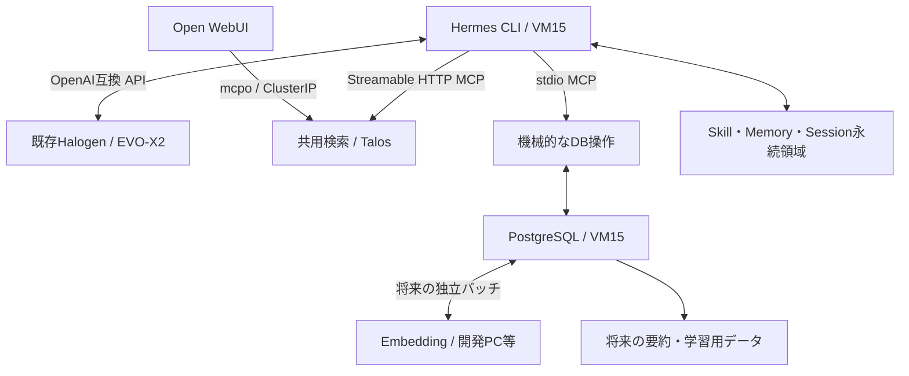

# keibaAI_nlp 引き継ぎ書 — 段階3B完了・自律収集研究の開始前

更新日: 2026-11-24（JST）
位置付け: 設計議論・実装・受入の経緯、確定方針、現行環境、次の設計課題を新しい会話へ引き継ぐための正本。個別の実行指示書ではない。
作成時にGitHubで照合した基準:
- keibaAI_nlp main: eef50f4a85e90456098ba9d9c8c5d166a33a87c4
- OpenWebUI main: e33a4ae4451b6cb9aec502a8ce00d1ec84b93064
- DivRoom main: 3df2143bf5abda3547b481e2180f2e93457a3267

## 0. 次のスレッドで最初にすること

**段階2A（NLP VM）、2B（DB）、3A（共用検索の技術受入）、3B（Hermes研究環境）は完了・レビュー受入済み。次は段階3Cの設計議論。**

新しいスレッドで行いたいのは、実装済み環境の再構築やDB設計のやり直しではなく、Hermesにどのような研究目的・個別タスクを与え、どのような探索手段を提供すれば、Hermes自身の探索方法とSkillが発展するかを検討すること。

直前の論点はYahoo検索の有効化である。ユーザーは「DDGS等も安定した公式APIによる取得とは限らない」「自己規制が厳しすぎるのではないか」「LLMによる代理取得ならYahoo検索を有効にできるのではないか」と問題提起した。技術的に有効化できることは確認したが、利用条件上の扱いと具体的な有効化指示はまだ確定していない。§7を読んでここから議論を再開する。ユーザーが全Webの自動取得を禁止したわけでも、Yahooを有効化する実装を承認済みとみなしてよいわけでもない。

本書は[11月22日の旧引き継ぎ書](2026-11-22_data_accumulation_handover.md)を更新する後継文書。旧文書のPoC移行必須、初期v3参照取込、詳細な証拠管理・時点検証、未確定のDB/VM構成等は、その後の合意・実装に従い読み替える。物理仕様は段階2B/3Bの指示書、現行DDL、設定・コードが正本。旧21テーブル案は採用しない。

## 1. 研究目的と合意した基本思想

本プロジェクトはkeibaAI_v3とは独立した競馬自然言語研究。目的は次の2本。

1. **人間が楽しむ下馬評・回顧・馬の履歴の整理**: レース別・馬別に関係者の発言、新聞、取材、予想記事等の原文を抽出し、必要時にLLMで出典付きの要約を作る。
2. **自然言語情報の追加的な予測力の研究**: 原文をEmbeddingして別の統計・機械学習モデルへ入力し、既存の競走成績・数値特徴等に対する追加価値を検証する。生成LLM自身に勝ち馬予想をさせること、好調/不調を手作りスコアへ落とすこと、生成LLMのFine-tuningは必須目的ではない。

### 1.1 収集対象・量と質

- 取得できる関連情報を広く蓄積する。収集時に予測力がありそうかをLLMに選別させない。G1・著名馬には記事が多く、条件戦や無名馬には少ないという偏りは自然なもの。各レースで同じ媒体や件数を揃える必要はない。
- ユーザーの重要な合意: 究極的には「記事本文、対象馬、対象レース、レース前/後」の4情報で管理できれば十分。自然言語の同定・分類の正確性を数値系v3並みに厳格化しない。多少の誤分類を許容し、データが豊富であることを重視する。
- 公開日時は得られる場合に保存すればよく、取得のために必ず追加調査する必要はない。LLMは文脈から人間同様に事前/事後を判断できる。日時をレース日と比較する固定ロジックを主判定にしない。明らかな事後情報の混入には注意するが、収集段階で全件の時点証明や厳密な検証は行わない。
- 一つの記事の前後区分は、その記事が関係する個別レースとの関係で決まる。過去走の事後記事は次走予測の材料になり得る。事後記事に事前発言が引用されていることを根拠に当該レースの事前記事へ扱い直さない。歴史的な文脈分類と厳密なas-of検証は区別する。
- サイトの利用条件・公開アクセス方針・レート制限を尊重し、アクセス制限回避、CAPTCHAや認証・有料壁突破をしない。公開情報全体に個別事前許諾や固定ホワイトリストを一律要求しない方向で議論した。具体的な取得・保存上の判断は§7の未決論点。

### 1.2 LLM・通常コード・Embeddingの責務

**収集と分類は同じHermesの自律的活動。Embeddingのみ別バッチ。**

Hermesに任せる: 検索語、探索先、追加調査、記事の理解、原文中の対象範囲、馬・レース・前後区分の判断、進捗の持ち方、経験からのSkill改善。収集と索引付けは別々の通常バッチに分割しない。原文を先にコミットするため、同定失敗時にも原文が残る。後からの訂正は可能だが、全件の再分類を常用する構成ではない。

通常コードに任せる: HTTP取得・応答状態、アクセス間隔、DB入出力、ID・hash・型・FK・原文範囲の機械的検査、重複防止、ベクトル生成・抽出。ここに意味の判定や検索戦略を実装しない。

Embeddingは原文を保存した後、数年分をまとめて生成してもよい。収集開始にEmbeddingを要求しない。モデル変更・再分割・再生成を独立に行える。通常のデータ抽出/学習用出力はSQLで完結し、毎回LLMやEmbeddingを呼び直さない。

## 2. 経緯と実施済みの検証

実測値は各実施レポートからの転記。本書作成時に実機へ接続して再試験したものではない。

### 2.1 11月22日のPoC

| 検証 | 結果・注意 |
|---|---|
| [CPU Embedding](../../reports/2026-11/2026-11-22_embedding_cpu_environment_poc_report.md)（5d2e2f6） | 開発PC Ryzen 7 5800X、16スレッド。Qwen/Qwen3-Embedding-0.6B revision 97b0c614be4d77ee51c0cef4e5f07c00f9eb65b3、1024次元、float32正規化。14短文0.77秒・18.2件/秒、RSS約2.84 GB。bf16は4.85秒。否定・極性を取り違える例あり |
| [G1自律探索](../../reports/2026-11/2026-11-22_g1_article_autonomous_search_poc_report.md)（b070dac） | 2024〜2026皐月賞24 URLの記録、23件の原文テキストをEmbedding。抜粋・検索snippet由来が多く原文なし1件。全文コーパスではない |
| [Yahoo検索ローカル比較](../../reports/2026-11/2026-11-22_hermes_yahoo_search_local_poc_report.md)（25a6484） | 実Yahoo検索11回HTTP 200、実429なし。DDGSは固定4クエリ中2件で失敗し他サービスにfallback。Hermes選択の追加6クエリから新規URL候補25件。URL発見と本文取得を区別。native tool call自体は当時未検証 |

否定・極性が意味検索で混同されたことは、教師あり予測モデルにEmbeddingが無価値という証拠ではない。モデルを比較したり、後で予測力を直接測る。LLMに好調/不調等の分類をさせて埋め合わせる方針は採用しない。PoCはすでに終了し、同じ小規模検証をインフラ構築ごとにやり直さない。

PoCデータは開発PCの keiba_nlp/data/poc/ にありGit管理外。g1_passages.jsonl は24件・31,060 B・SHA-256 e2eaf61190353c4b10cc3175b8a24dfe9b69d577c42189df192700266810ad16。**旧24件を通常DBへ移行する計画は撤回済み。** 既存PoCは保全しているだけで、現在の通常DBには1件も入っていない。段階3B最終照合ではPoC 6ファイル81,374 Bを保全した。

### 2.2 VMとDB構築

- 段階2A: 初回Ubuntu autoinstallはidentity階層等の不備で停止した。設定を修正し、VM15の既存本体へUbuntu Server 24.04.5 LTSを正常導入。V1〜V11合格。通常rebootから約23.3秒でQuadlet復帰。ESXiホストの約37時間23分の時計ずれは独立残件。VM15のchronyは正常。ホストの時計修正や他VM操作をNLPの作業に混ぜない。
- DB設計では一時21テーブル案を検討したが、目的に比して過剰であるとのユーザー指摘により撤回。記事本文・対象馬・対象レース・前後区分の4情報と必要最低限の管理項目に整理した。8テーブルを確定。
- 段階2B: PostgreSQL 16.16 + pgvector 0.8.7をVM15に配備。B1〜B10合格、合成30行の全列hashがサービス・VM再起動前後で一致。通常DB8表0件、使い捨てDB削除済み。既存DBのPoC移行なし。
- LAN DB接続のDNAT/FORWARD問題はVM15内の宛先・送信元・interface限定規則で対応。UFW維持。段階3Bのhost network接続では既存LAN HBAで認証成立し、恒久HBA変更なし。

### 2.3 共用検索基盤（段階3A）

- 11/22にOpenWebUIの既存検索Podへ同一イメージのnative Streamable HTTPコンテナを追加。既存mcpo/stdio経路を維持し、emptyDirの/sharedで状態を共用。Hermes等向けNodePort 30081を既存承認範囲で公開した。
- 現行旧版の問題: 短い429待機が共有されない、再試行がゲートを迂回、再429が2回目Retry-Afterを無視、429認識前に他プロセスがHTTP開始し得る。段階3Aで全HTTP試行を共通_attemptへ集約。HTTP応答と429状態書込までfilelock、sleepはlock外、再入時に期限を再確認。実HTTP開始間隔3秒、試行ごとの待機予算20秒、短RA最大1回再試行、未指定/不正RA既定30秒、長RAは実期限を共有して返す。本文2MB/8000字切り詰めと途中通信失敗の状態判定も修正。
- 実装source 91e1f348、CI run 45319816796。従来24件を含む40試験、独立2プロセス競合試験合格、旧4不具合の再現と解消を確認。
- 初回新版配備はpull直後のDiskPressureをapply直前に再取得せず、Recreateで旧Podが消えて新PodがPending。約4分48秒で旧版復旧。空き容量回復後も5分のPressure transitionが影響した。再配備指示書ではpull後・直前の実空きと配置条件を必須とし、必要時だけTalos VMDKを32→64 GiBに拡張できるようにした。
- 再配備時は新旧digestがキャッシュ済み、空き19.83 GB > 必要10.17 GB。拡張・VM停止なし。初回の監視処理が空EndpointSliceを扱えず切戻し、ユーザーが承認した追加1回で正常配備（観測停止約7.4秒）。監視手順をREADME修正。Open WebUI・Times Gateも正常。R1〜R3/S8〜S10合格。現在shared.2。
- Hermes/VM15から本番の許可ページ取得、同digest隔離fixtureの模擬検索が成立。実Yahoo検索は0件。検索APIの実取得成功や長期利用許諾を示す受入ではない。

### 2.4 Hermes研究環境（段階3B）

- 公式安定版Hermes v0.22.2を採用。調査時のv0.23.3は通常CLIがgatewayへ会話を渡すため、gatewayなしで直接AIAgentを起動できるv0.22.2を選択した。今回の構成に合わせた版選択であり、最新化自体は目的でない。
- VM15にPodman/Quadletで配備し、SSH CLIから利用可能な待機状態。Local LLMの主/補助推論、共用fetch_page、DB操作stdio MCP10機能、標準Skill/Memory/Sessionを実装。研究固有の探索Skillなし。
- DB操作44呼出と8表SQL照合、実Hermes/Local LLMから記事保存→関連付け→取得→進捗更新など6 tool call成功。H1〜H10全件合格。試験DB・profile・HBA回収。通常DB開始終了8表0件、fingerprint一致。
- Hermes自身のskill_manageで試験Skill作成・更新、memory(add)成功。説明の60文字制限に対し自分で修正して作成。コンテナ再作成後にSkill/Memory/hashと5セッション（31メッセージ）保持、新セッションから更新済みSkillとrun進捗を取得。人間によるSkill手書きでの代用なし。
- 圧縮設定/実行を確認。Halogen有効context 262,144、通常閾値131,072。割合0.50だけでは実効196,608だったので絶対上限も指定した。試験profileで低閾値を使い、合成履歴24→4メッセージ、推定3,194→2,162 tokens、補助LLM1要求、約70秒、fallbackなし。長時間運転・最大context枯渇耐性は未検証。
- 公式コードや実装を再度レビューし、段階3Bの追加改修は不要と判断。**ただし実記事を自律収集できることやSkillの質・改善効果が証明済みという意味ではない。**

## 3. 現行構成と運用境界

| 対象 | 現行実測・接続 |
|---|---|
| ESXi | esxi-divroom（192.168.0.5）、6.7.0 build13006603。既存VM13 Talos、VM14 ubuntu-gateway、VM15 keiba-nlp |
| NLP VM15 | 192.168.0.14、Ubuntu Server 24.04.5 LTS、2 vCPU/8 GiB/100 GiB thin、LVM/ext4、rootful Podman 4.9.3 + Quadlet、SSH鍵・chrony |
| Talos共用検索 | VM13 divroom-talos-01 / 192.168.0.11、Talos v1.13.8/K8s v1.36.2、2 vCPU/4 GiB/32 GiB thin、node talos-prb-lss |
| Local LLM | EVO-X2 192.168.0.13:8731/v1、Halogen halogen-qwen3.8-flash-next、認証不要の既存LAN API |
| PostgreSQL | 192.168.0.14:5432/keiba_nlp、アプリ nlp_app、SCRAM、承認済みLAN内TLSなし |
| Hermes | VM15 nlp-hermes.service、公式v0.22.2派生image、SSHからCLI。gateway/cron稼働0 |
| 開発PC | Windows、研究・実装・将来のEmbedding初期実行。継続収集時の必須起動機にはしない |
| v3 | 独立。現時点でNLPからDB/サービスへの連携なし。mini-v3、EVO-X2等への新規常駐物なし |

通信・責務:



OpenWebUI/Talosは既存共有基盤で、NLP固有の処理を載せない。ESXi/Talos/他VM/他プロジェクトの変更は個別指示。v3の参照や書込を初期収集の前提にしない。

## 4. 確定DB設計・データの扱い

正本: [段階2B指示書](../../instructions/2026-11/2026-11-24_nlp_db_build_instruction.md)、[DDL](../../../infra/nlp-vm/db/migrations/001_initial.sql)、[DB README](../../../infra/nlp-vm/db/README.md)。DDLを確認せず旧文書の列名を採用しない。

| テーブル | 内容 |
|---|---|
| articles | 一つの取得版。article_id(UUID)、source_url、title/media/published_text任意、body、body_kind、hash、collected_at、run_id任意 |
| text_units | unit_id(UUID)、article_id、原文内start_char/end_char。全文unitを自動生成。別範囲のunitも可 |
| unit_targets | unit_idに対する馬×レースの必要な組とphase。ID不明時はhorse_label/race_labelまたはNULL |
| horses | horse_id(UUID)、horse_name、normalized_name（生成列）、birth_year任意 |
| races | race_id(UUID)、race_name/race_date/domain_id/race_keyは判明分のみ |
| embeddings | unit_id/config ID/chunk_index、unit内範囲、可変次元vector、生成時刻 |
| embedding_configs | モデル名・revision・次元・前処理/分割設定・config hash |
| collection_runs | run_id(UUID)、task/progress JSON、status、時刻・エラー |

- 同一URL・取得種別・本文hashで一意（NULLも同値扱い）。同一版再登録は同じID、別内容は別版。別URLの出典は保持。body_kind=full/excerpt/snippet/none。取得できない・保存できない場合はnone等。要約を原文の代用にしない。出典を残すが記事本文に対する過剰なエビデンス管理は不要。
- 馬名は一意キーにしない。NFKC＋Unicode空白除去、同名別馬を許容。レースは内部ID、domain_id+race_keyが判明した場合のみ部分一意。race_keyはYYYYMMDD/JJ/RR書式。JRA/NARの外部ID対応は将来の別作業。
- 原文の位置はUnicodeコードポイント0起点・半開区間。原文保存後に対象の範囲を関連付ける。対象を直積しない。phase=pre/post/mixed/unknown。確信度、発言者、話者マスタ、好調/不調、予想評価、時点証明・日程履歴・検索ログ専用テーブルは追加しない。
- 全文unitはその記事全体の保存・後日のEmbeddingの選択肢。全文を無関係な馬へ機械的に割り当てない。馬/レース関係は必要な範囲で記録する。
- Embeddingはモデル条件をIDで区別し、各unitにモデル固有のchunk範囲を持たせる。次元と範囲はDBで検査。同一unit/configの全chunkを一トランザクションで保存、未生成を収集失敗としない。ANN索引・固定ベクトル集約は未導入。
- v3連携は初期はなし。後続研究でdomain/race_key・blood_reg_no等の対応を現行v3のキー契約に沿って設計し、読み取り専用exportを用いる。NAR仮ID→正式IDの変更を考慮。出走馬番はv3側から対応を取る。DuckDBの全面置換やv3本番接続は別task。
- 最初の予測力検証は対象レースのpre資料を中心とする。mixed/unknown/postをそのレース自身の事前資料へ混入させない。日付不明preはDB上保存・抽出可能。ただし分類だけで当時の公開を証明したとはみなさず、厳密なas-of利用は後の研究で扱う。

DB実体 /srv/nlp/pgdata、PostgreSQL 16.16 + pgvector 0.8.7、shared_buffers=512MB、max_connections=50、UTC、通常DBの全8表0件。初期migrationのcatalog fingerprintは 2a303dd483dd85e517a71b60870e7d06b1151da55f39b44b629aafb38a863b3e。所有者postgres、アプリnlp_appは通常DMLのみ、保護列・DDL・管理操作不可。秘密値はGit/会話に出さない。

## 5. Hermesの実行方法・提供ツール

正本: [Hermes README](../../../infra/nlp-vm/hermes/README.md)、[設定](../../../infra/nlp-vm/hermes/config.yaml)、[固定契約](../../../infra/nlp-vm/hermes/AGENTS.md)、[Quadlet](../../../infra/nlp-vm/quadlet/nlp-hermes.container)。

```sh
ssh nlp@192.168.0.14
sudo systemctl status nlp-hermes --no-pager
sudo podman exec -it --user 10000:10000 --workdir /opt/nlp-research nlp-hermes hermes chat --cli
```

単発CLIはREADMEの hermes chat -Q --max-turns ... -q ...。実行する指示・予算・終了条件は段階3Cの合意後に決める。上記は接続方法であって実収集の開始指示ではない。同じprofileのセッションは一度に1件。

| 配置/設定 | 内容 |
|---|---|
| image | 公式v0.22.2、source d923a5eb487a17c0a68801bba9ef0f56c81040a8、固定base digestと31 wheel/hashの独立venv |
| 稼働image | localhost/nlp-hermes:0.22.2-stage3b、ID sha256:e71b1822fb1cccf4a6a43c8a22d90809650d200e26b8d4025dd01abbfe09dadd |
| /srv/nlp/hermes → /opt/data | writableなSkill/Memory/Session/profile/log。UID/GID10000、0700 |
| /srv/nlp/hermes-runtime/config.yaml | 読取専用通常profile設定。管理側が変更。単一ファイルbindの更新はstop/startで反映 |
| /opt/nlp-research/AGENTS.md | root所有の短い固定契約。外部取得の制約、研究目的、保存契約、自己改善を許可 |
| /opt/nlp-db/ | DB用stdio MCPのコードと独立venv、MCP SDK 1.30.0 / psycopg 3.3.9（Hermes本体のSDKは2.0.0） |
| /run/secrets/nlp_app | アプリ用秘密だけ読取専用mount。管理者秘密を渡していない |
| resource | memory 3 GiB、CPU 1.5相当。非root runtime、host network、追加公開portなし |
| 通常モデル | custom / halogen-qwen3.8-flash-next / http://192.168.0.13:8731/v1 |
| 圧縮 | enabled、context 262144、threshold 0.50、threshold_tokens 131072、protect_last_n 20 |
| 補助推論 | 原則同じLocal LLM、fallback_model=[]、background_review.enabled=false |
| 起動 | sleep infinityで待機、systemd自動起動。gateway/cronなし。明示CLI起動まで探索しない |

### 5.1 公開されている16ツール

DB操作10機能（公開名prefix mcp__nlpdb__）:
- find_articles / get_article / save_article
- find_horses / save_horse
- find_races / save_race
- save_targets
- get_runs / save_run

外部取得: mcp__shared__fetch_page（共用MCP）。**現時点でyahoo_searchはモデルに非公開。**
標準: skills_list、skill_view、skill_manage、memory、session_search。

詳細引数はREADMEと [server.py](../../../infra/nlp-vm/hermes/server.py)、[store.py](../../../infra/nlp-vm/hermes/store.py)、[targets.py](../../../infra/nlp-vm/hermes/targets.py)を参照。DB toolは純粋なPython/SQL、1呼出1トランザクション、接続4秒・SQL5秒・lock3秒、例外rollback。任意SQL、Embeddingへの書込は公開しない。

利用上の要点: save_articleで原文先行commit→save_targetsで索引。既存IDを候補検索し、明示的なcreateと安定UUIDで新規作成。save_targetsは既存unit/全文/文字範囲/完全一致引用を指定可能。反復引用には候補範囲を返す。UUIDや文字位置をLLMが扱いにくい場合は、実際の収集観察から必要な機械的補助を検討する。本文取得や一覧にはpaginationがある。複数の既存対象を統合する等の高度な訂正は未実装、実需要が出てから対応。DB設計を再度広げる理由ではない。

### 5.2 Skillの自己改善と管理境界

ユーザーが特に重視している点: **Hermesの価値は、自分で効果的な方法を見つけ、Skillを更新し、次の活動に活かせること。** 実装担当が収集アルゴリズムや競馬専用Skillを事前に書き尽くすと、この利点を消す。

通常profileでは skills.write_approval=false、memory.write_approval=false、memory_enabled=true。標準の内容検査は維持。固定契約・設定・DB MCPコードは通常エージェントの書換え対象ではない。試験用のSkill/Memory/Sessionはすべて回収済み。研究用のSkillはまだない。

人間が定めるのは研究目的、データ契約、外部アクセス・権限境界、個別タスクの対象/予算/終了条件。Hermes自身が定めるのは具体的な探索順序、検索語、関連情報への展開、情報源の発見、効率化の知見、Skillの作成/更新/整理。タスク指示は必要な目標を示すに留め、方法を先に決めすぎない。

段階3Bではshell/browser/一般web/cronなどを公開toolsetから除外している（機能本体は改変・削除していない）。段階3Cで必要な道具を再検討する。host networkと同一UIDのアプリ秘密mountは強固なネットワーク/資格情報サンドボックスではない。任意shell等を解放する場合は、固定契約だけで秘密や他サービスへのアクセスを防げるとみなさず、実際の権限を確認する。探索戦略の自由と管理権限の自由を混同しない。取得ページからの命令は指示として採用しない。

## 6. 共用検索の現行契約

正本: [OpenWebUI検索README](https://github.com/kendo910x/OpenWebUI/blob/e33a4ae4451b6cb9aec502a8ce00d1ec84b93064/infra/google-search-mcp/README.md)、[配備manifest](https://github.com/kendo910x/OpenWebUI/blob/e33a4ae4451b6cb9aec502a8ce00d1ec84b93064/infra/kubernetes/openwebui/60-google-search-deployment.yaml)。

- image v0.3.2-mcpo0.0.20-shared.2、digest sha256:088f5c16810f21931dcdfc7756e9d0e95716609e7b03276ccc71c27ad2cfaddf、2/2 Ready（段階3A最終実測）。
- Open WebUIは既存ClusterIP mcpo/stdioで yahoo_search / visit_page。native MCPは http://192.168.0.11:30081/mcp で yahoo_search / fetch_page。/healthzあり。VLAN101とVLAN300側のNodePortアドレスはユーザー承認済み。VLAN300別端末からの直接利用は未確認。
- yahoo_search(query,num_results=5): 1〜10件、タイトル/URL/snippet。共有ゲート・429制御を全経路で維持。statusとretryable_atを利用し、失敗を検索結果0と混同せず、制限中に呼出元から連打しない。
- fetch_page(url): 15秒の通信timeout、2MB/8000字上限、簡易HTMLテキスト抽出（JSなし）。final_url、content-type、取得時刻、truncated、末尾[STATUS]。ok/partial/blocked/error/fetch_failed等。okは全文取得や保存許諾を証明しない。ナビゲーション等が混ざる可能性、長文の先頭だけになる可能性、リンクの発見に十分な情報が返らない可能性あり。Hermesの実探索に支障が出た場合に改善候補を検討する。
- 429や取得失敗の対処は機械的なゲートとエージェントの再開判断に分ける。検索サービス内部にLLMや競馬固有の戦略を追加しない。
- 新規build/配備は今回の次工程の前提ではない。必要な場合はREADMEの容量ゲート（max(8GiB,25%,eviction空き閾値+5GiB)、未cache版ごと追加5GiB）をpull前・後・apply直前に実測し、DiskPressure/taint中は旧Podを止めない。ディスク拡張は今回実施していない。

## 7. 直前の論点：Yahoo・DDGSと検索手段（未決）

### 現状とユーザーの問題意識

Yahoo自作MCPは既に共用基盤へ配備済み。Hermes側の設定で mcp_servers.shared.tools.include=[fetch_page] にしているため、通常profileでは検索toolを呼べない。**これは技術障害ではなく設定上の制限。** Open WebUIの既存yahoo_searchは今回停止・撤去していない。

前回、Yahoo robots.txtの User-agent: * / Disallow: /search? を確認し、ユーザー指定で段階3A/3Bの試験を模擬検索と許可された公開ページ取得に限定した。これらの段階で実Yahoo検索は0件。ただしPoCでは実検索の技術成功が確認されていた。

その後の会話でユーザーは、DDGS経由のGoogle検索なども成功したり失敗したりで、DDGSが規約を完全に守っているとは思えない、自己規制が厳しすぎるのではないか、と指摘した。質問の主眼は一般的な規約解説ではなく「既に用意したYahoo検索を有効にできるのではないか」である。新しい会話ではこの論点を避けて同じ説明を繰り返さない。

### 整理済みの事実と区別

- robots.txtはアクセス権限を与える技術的な認証機構ではない。違法性、利用規約、アクセス制御、負荷は同じ概念ではない。
- 先の議論ではYahoo公式案内にクロール/スクレイピング等による機械的な情報収集を禁止する記述があると確認・説明した。現在の正確な適用範囲、条件、例外は必要時に公式情報を再確認する。[robots.txt](https://search.yahoo.co.jp/robots.txt)、[Yahoo!検索ヘルプ](https://support.yahoo-net.jp/PccSearch/s/article/H000015794)、[RFC 9309](https://www.rfc-editor.org/rfc/rfc9309)。
- Hermesが検索語を考えることと、MCP内部のrequests/BeautifulSoupによる自動HTML取得とは別。LLMであることだけから機械取得の例外だとは判断できない。一方、LLMによるWeb探索全体を禁止する結論にもならない。
- DDGSは公式APIと同義ではなく、backendによってHTML取得・抽出を行う。PoCでも日本語競馬クエリの失敗/fallbackを確認した。DDGSへ替えれば利用条件や安定性が自動的に解決するわけではない。既存の検索基盤を構築した理由は、検索の実用性と共有制御である。
- 技術面ではHermes通常profileのMCP公開設定変更でyahoo_searchを追加できる（実機変更はまだ行っていない）。利用条件上の判断、実際に使う探索経路、実施範囲を段階3Cで決める。明示的な制限に反する取得・回避操作は採らない。既にある実装を削除したり、Yahoo禁止をHermesの恒久的な設計思想とみなしたりしない。
- 代替・補完候補として、条件の合う公式検索API（Brave等は候補、料金・日本語/古い競馬記事の検索品質は未評価）、サイト自身が提供する公開アーカイブ・サイトマップ・RSS等が挙がった。課金や新規アカウント、固定サイト巡回、検索backendの追加・fallbackは未決。利用可能な探索経路を検討し、Hermesの探索自由度を確保する。

ユーザーの判断を取り違えない: 自己規制への疑問は表明済みだが、規約に反して取得する承認やYahooの設定変更の実行指示は出ていない。全サイトについて個別許諾を得るような一律の厳格化も求めていない。技術と利用条件を具体的に区別して議論する。必要な判断を済ませるまで通常profileの設定は現状維持。

## 8. 次の計画（合意済みの区切りと未決の内容）

| 工程 | 状態・目的 |
|---|---|
| 2A | 完了。NLP VM |
| 2B | 完了。8表DB |
| 3A | 技術受入完了。共用検索、429・実クライアント接続 |
| 3B | 完了。Hermes CLI、道具、永続化、自己更新機能の試験 |
| **3C** | **次の設計・試行**。探索手段と初回タスク、自律性・自己改善の観察 |
| 4 | 継続収集。過去記事を広く蓄積、定期実行・再開、バックアップ整備 |
| 5A | Embedding独立バッチ、モデル比較、再生成、SQL抽出 |
| 5B | 馬/レース別閲覧・要約。5A完了は必須でない |
| 6 | v3との読取専用データ連携・予測力検証 |

### 8.1 段階3C — 実装を始める前に議論すること

1. 探索経路: §7のYahoo利用条件と有効化判断、利用可能な検索/アーカイブ等。実際に使える発見手段を確保する。現状fetch_pageだけでは既知URLの取得しかできず、自由な検索を始められない。
2. Hermesへの初回依頼: 研究目的・対象範囲・終了条件を示す程度の短い個別タスクを検討する。JRAの過去G1を足掛かりにする方向は既出だが、期間、初回の対象レース、予算、プロンプトの具体文面は未決。
3. 自己改善の観察: 事前に収集Skillを書かず、Hermesが検索語を組み替える、情報源を発見する、無駄な方法を見直す、次の収集に役立つ知見を自分でSkill化する様子を見る。Skill数をノルマにしない。毎回Skillを強制更新させるか等も未決で、既存標準機能の自然な挙動を尊重する。
4. 記事を保存する権限・内容、分類精度の許容、収集予算と中断方法を決める。実収集の開始は別指示。初回の通常DBへの投入方法とデータ保全も明確にする。
5. 運用への示唆: 実際の新規記事数、本文取得可能割合、重複、失敗原因、LLM処理時間、context増加と圧縮、Skillの再利用、セッションをまたいだ継続性を必要十分な範囲で観測する。検証専用の精度指標や固定探索アルゴリズムを先に作らない。実際のボトルネックに応じ道具を修正する。

ここで初回指示を確定せず、ユーザーと設計議論を行う。本書をそのままHermesに長い収集promptとして与えない。固定規約は最小限、作業依頼は簡潔、学んだ方法はHermes自身のSkill、という三層を維持する。過去に作成したPoCクエリや媒体リストは参考資料に留め、初期Skillにコピーしない。

### 8.2 段階4 — 収集の継続運用

- 3Cで実活動を観察した後、必要な範囲で収集を継続運用に移す。指定対象を徐々に広げる。実際の起動・中断再開・定期スケジュールの方式は未決。夜間バッチ主体は配置設計上の候補であり、具体的な時間帯の決定ではない。
- 本格蓄積に入る前にバックアップを設計・整備する。対象はDB、HermesのSkill/Memory/Session等の永続領域、設定/再現に必要なもの。Gitはコード/設定/docsの正本であってDBやSkillの動的資産のバックアップではない。秘密/記事の権利/容量/復元方法を考慮し、バックアップから復元を確認する。頻度・保存先・保存期間は未決。
- 段階3Bでは長期運転を試していない。収集実行時のCPU/メモリ・DB容量・Local LLM負荷と圧縮の実効性・制限・中断時の進捗を見て必要な対策だけ実装する。v3本番の処理に影響させない。

### 8.3 段階5・6 — データ利用

Embedding生成は別バッチで、収集と並行または後追い実行。開発PCのCPU/GPU等を候補に、蓄積済み実記事でモデル・分割・処理速度・容量を比較する。Qwen3-Embedding-0.6Bは動作確認済み候補で採用確定ではない。モデルの意味検索精度と予測力は別に評価する。SQLで馬別/レース別/モデル別の保存済み原文・ベクトルを取り出す。閲覧用要約は必要時に生成し、原文Embeddingの代わりに使わない。

予測研究では対象レースのpre文章を出発点に、既存モデルとの比較、情報量の偏り・事後リークの影響、記事がない馬、複数ベクトルの入力構成等を検討する。今のDBで固定的な集約方法やv3改変を決めない。

## 9. 残件・独立した注意事項

- 検索手段の利用条件・有効化、初回Hermesタスク、自己改善の観察方法は§7〜8の未決事項。
- 現行VM/Hermesによる実Yahoo検索・実競馬記事の取得/保存、長期間の自律運転、DBへの実Embedding生成、予測研究、定期実行、バックアップ運用はまだ未実施（初期PoCの実検索・原文抜粋収集・Embedding試験とは区別）。通常DB8表0件は正常な現段階の状態。
- ESXiホストの時刻ずれ（11/22報告約37時間23分）は別task。ゲスト自身の同期を確認し、勝手にホスト時刻や他VMを変更しない。
- 段階3Aのブラウザ操作で無関係な別タブのURL内認証情報が操作ツール出力へ表示されたと報告あり。Gitやレポートには値を含めていない。該当サービスの秘密の特定/ローテーションは別件で、実施済みとは確認していない。値を再出力しない。将来のブラウザ操作は無関係タブや認証URLを出力しない。
- 開発PCの元作業ツリーには旧未追跡5ファイルが残り、最新mainより古い状態だったため、独立worktreeを利用してきた。git fetchとstatusを行い、未追跡/PoC/他taskの差分を保全し、強制clean/resetをしない。作業用ブランチが古いことを本番の状態と混同しない。
- AGENTS.mdや旧配置/引き継ぎ資料には初期PoC時代の詳細な証拠・時点管理や馬名キー等の案が残る。段階2Bの新確定仕様とユーザー個別合意を優先。今後共通規約を改訂するなら、過剰な規制を追加せず最新方針に整合させる。本書ではAGENTS.md自体は変更しない。

## 10. 参照するGit正本・受入資料

ユーザーの依頼を受けたら、最新origin/mainを確認して該当タスクの正本を読む。設計議論→合意→実装指示書→Codex等の実装・実測→レポート→レビューの手順を維持する。指示書の作成/commit自体は実機変更や実収集の承認ではない。担当を特定モデルに固定しない。

| 資料 | 基準・用途 |
|---|---|
| [旧引き継ぎ](2026-11-22_data_accumulation_handover.md) | 歴史資料。本書と矛盾する旧案は採用しない |
| [配置設計](../../design/2026-11-22_nlp_infrastructure_placement.md) | VM配置・既存基盤の境界 |
| [2A復旧・受入レポート](../../reports/2026-11/2026-11-22_nlp_vm_recovery_report.md) | VM導入完了、814d5144 |
| [2B指示書](../../instructions/2026-11/2026-11-24_nlp_db_build_instruction.md)・[受入レポート](../../reports/2026-11/2026-11-24_nlp_db_build_report.md) | 確定8表、指示909360f9、実装c059243f、レポート5566b023 |
| [3A修正・初回失敗](https://github.com/kendo910x/OpenWebUI/blob/a5779b40e50cf0d5eb40c7a7ba96e5736b34ecfa/docs/reports/2026-11/2026-11-24_shared_search_cooldown_fix_report.md) | source 91e1f348、レポートa5779b40、S1〜S7 PASS |
| [3A再配備指示書](https://github.com/kendo910x/OpenWebUI/blob/e33a4ae4451b6cb9aec502a8ce00d1ec84b93064/docs/instructions/2026-11/2026-11-24_shared_search_redeploy_instruction.md)・[完了レポート](https://github.com/kendo910x/OpenWebUI/blob/e33a4ae4451b6cb9aec502a8ce00d1ec84b93064/docs/reports/2026-11/2026-11-24_shared_search_redeploy_report.md) | 指示e6e07b01、配備96976576、レポートe33a4ae4。技術受入完了 |
| [3B指示書](../../instructions/2026-11/2026-11-24_nlp_hermes_environment_instruction.md)・[実測レポート](../../reports/2026-11/2026-11-24_nlp_hermes_environment_report.md) | 指示11dfee55、実装756260c4、レポートeef50f4a。H1〜H10 PASS |
| [Hermes README](../../../infra/nlp-vm/hermes/README.md) | SSH/CLI・設定・ツール・永続化・再現手順 |
| [DivRoom接続正本](https://github.com/kendo910x/DivRoom/blob/3df2143bf5abda3547b481e2180f2e93457a3267/docs/infrastructure/kubernetes_access.md) | 共有Talos/ESXiの構成・境界。無断変更しない |

**新スレッドの再開点は、§7と§8.1。完成済みのDB・Hermes環境を維持し、ユーザーが求める自律探索と自己改善を実際の収集活動へつなげる設計を行う。**
